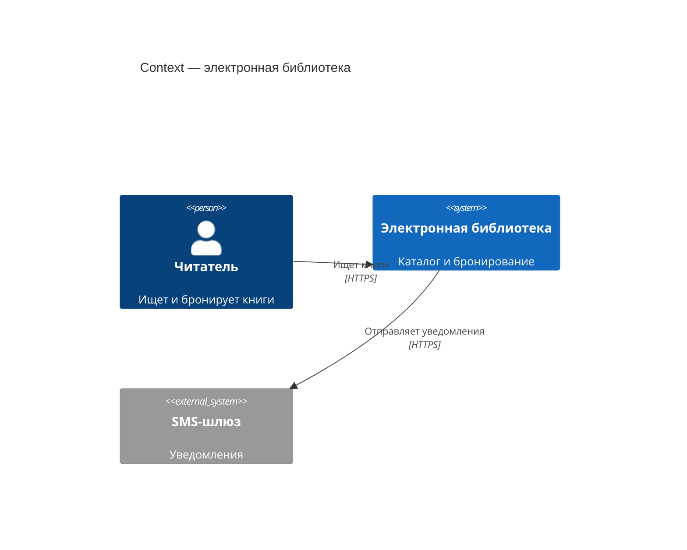
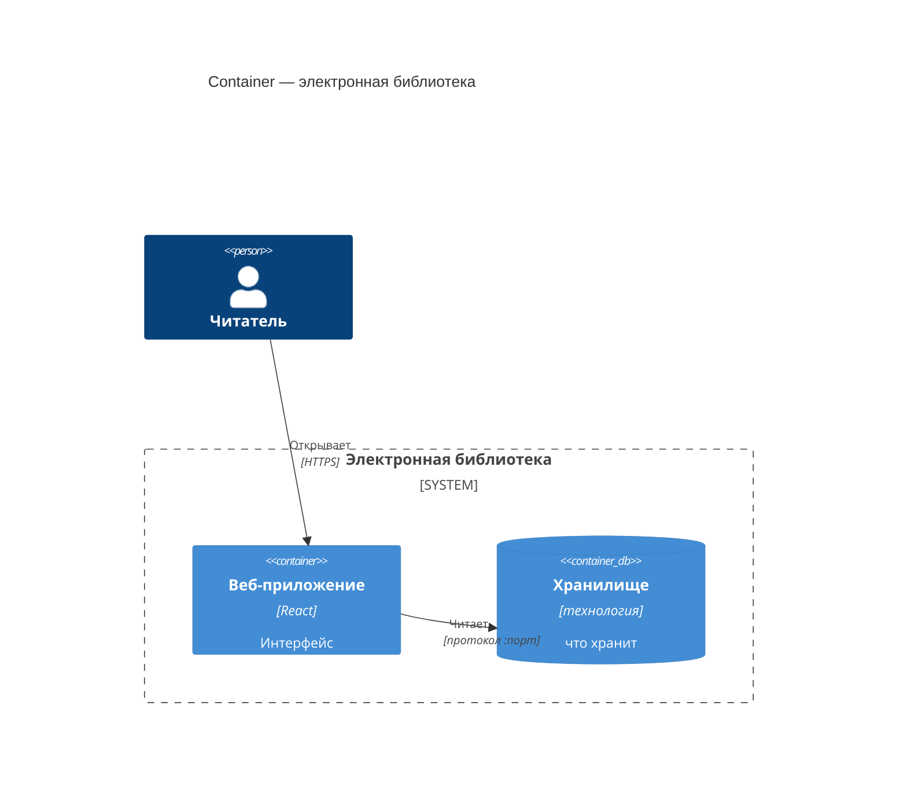

# Шпаргалка: диаграммы C4 в Mermaid

Пример ниже — про **библиотеку**, а не про вашу систему. Не копируйте его: используйте только как образец синтаксиса.
Проверять диаграммы удобно на https://mermaid.live (вставить код → справа появится картинка → Actions → PNG).

## Элементы

| Запись | Что рисует |
|---|---|
| `Person(id, "Имя", "Описание")` | человек, пользователь |
| `System(id, "Имя", "Описание")` | ваша система целиком (уровень Context) |
| `System_Ext(id, "Имя", "Описание")` | внешняя система, не ваша |
| `System_Boundary(id, "Имя") { ... }` | рамка вокруг частей одной системы |
| `Container(id, "Имя", "Технология", "Описание")` | запускаемая часть: приложение, шлюз |
| `ContainerDb(id, "Имя", "Технология", "Описание")` | хранилище: база, кэш |
| `Container_Boundary(id, "Имя") { ... }` | рамка вокруг частей одного контейнера |
| `Component(id, "Имя", "Технология", "Описание")` | часть внутри контейнера |
| `Rel(откуда, куда, "Что делает", "Протокол")` | стрелка-связь |
| `UpdateLayoutConfig($c4ShapeInRow="2", $c4BoundaryInRow="1")` | сколько фигур в ряд (делает схему читаемой) |

Первая строка блока задаёт уровень: `C4Context`, `C4Container` или `C4Component`. Затем `title ...`.

## Образец: уровень Context (библиотека)



## Образец: уровень Container (фрагмент)



## Частые ошибки

- Кавычки «ёлочки» вместо `"` — диаграмма не строится.
- `id` с пробелами или дефисом в начале — используйте латиницу без пробелов: `api`, `db1`.
- Связь на элемент, которого нет (опечатка в `id`) — стрелка не появится.
- Нет `title` — проверка `check-arch.sh` может не найти уровень диаграммы.
- В `architecture.md` блок должен начинаться строкой ` ```mermaid ` и заканчиваться ` ``` `.
